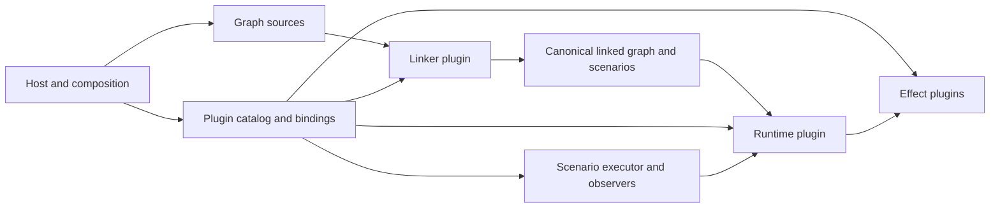

# Language-independent plugin architecture

**Status: architecture target with a first execution slice implemented.** [Remote execution](remote-execution.md) documents explicit place/port YAML, arc transport bindings and a single authority invoking remote HTTP/JSON executors. Other plugin roles remain Go APIs; this document describes the broader target, not a claim that all contracts are implemented. Package distribution and additional transports remain open.

## Goal and scope

Every compiled Meshwork component is usable as a plugin behind a language-independent contract: graph discovery/import and linking, runtime execution, transition effects, scenario executors, and observers. A plugin can live in any repository layout and be shared without linking the application graphs beside it. A host composes explicitly selected plugins with separately selected graph sources. Plugins may be implemented in different languages and distributed through different channels, provided they implement the same contracts.

A small bootstrap establishes the selected components and their connections. It is also replaceable compiled software, not a privileged Go API or a recursively loaded plugin requirement. It must have enough local knowledge to obtain a plugin implementation and establish the chosen transport; the mechanics remain an implementation decision. Each transition has a selected executor implementation supplied as a compiled binary; transition executors may be colocated or placed on different machines. Whether separate transitions run as separate processes or may share an address space is a deployment and executor-loading decision, not yet specified.



The diagram shows logical contracts, not processes, network connections, or required deployment order. Graph source selection and plugin selection are separate. The linker links computation; a distinct composition step resolves the linked graph's implementation identities against explicitly supplied plugin exports. No plugin imports a target application graph merely to be usable with it.

## Contracts and component roles

All contracts describe values and operations independently of programming language and transport. A concrete protocol must specify encoding, framing, request correlation, lifecycle, cancellation, error mapping, limits, and compatibility before implementations can interoperate. No existing Go interface is itself that protocol.

| Role | Contract responsibility | Current Go implementation or boundary |
| --- | --- | --- |
| Discovery and import | Accept configured source roots and selected formats; produce graph/scenario contributions and source diagnostics without running effect code. GraphML remains an input to the same canonical model. | `linker.Discover`, GraphML import |
| Linker | Resolve identities, bindings, references, merge and validate contributions; return canonical graph definitions, scenarios, provenance and diagnostics. On structural conflict return no partial linked result. | `linker.LinkFiles` and `meshwork.Library` |
| Runtime | Instantiate a linked graph against effect bindings; own markings, reservations, attempts, clock capabilities and atomic commits; expose bounded operations to scenario executors. | `meshwork.Runtime` |
| Transition executor | Execute one selected transition using its named input and output ports and attempt-scoped capabilities. Its implementation is supplied as a compiled binary; executor type can default and be overridden per transition. Its output does not independently commit a marking. | `remote.Prepare` binds per-transition native or HTTP/JSON executors |
| Scenario executor | Execute a scenario against the selected runtime and effect bindings; honor cancellation and report completion or failure. | Test and stream executors |
| Observer | Receive execution lifecycle notifications around the chosen executor, without being another executor. | `ExecutionObserver` |

A single distributable may export several roles; each export is independently identified and selected. Source adapters, linker and runtime are replaceable implementations of their respective contracts, not new graph vertex kinds. Multiple compatible source adapters may contribute to a link; a composition selects one linker, a runtime contract for a graph instance, one transition executor per transition, and exactly one scenario executor per scenario, with zero or more observers. A default transition executor type may be overridden for an individual transition; the configuration syntax and precedence remain open. Additional concurrent runtimes or graph instances require separate explicit instance identities and markings.

## Identity, linking, and sharing

- Graph authoring files can occur anywhere within configured source repositories. Their namespaces, bindings and graph references determine computational identity, as today; repository directory layout does not introduce graph identity. Discovery and linking do not execute plugin code.
- The graph's transition implementation is a logical effect identity. It is neither a source file path nor a language-specific import. The host supplies explicit bindings from those identities to effect exports. Existing opaque keys, including keys that look like filenames, remain meaningful as logical identities during migration.
- A separately supplied plugin catalog describes the available artifacts and their exports, roles, contract versions and implementation identity. A deployment binds selected exports and their configuration. The catalog need not live with the graph or plugin source, and plugin sharing does not require importing the source project's application graphs. The representation, naming, version selection, acquisition and integrity policy for a catalog remain open; the catalog is not a graph or an execution instruction embedded in graph YAML.
- Resolution must fail before execution on missing, ambiguous, duplicate or incompatible bindings; errors must identify the logical identity and relevant providers. Resolving a plugin does not alter the canonical graph or silently change a transition's selected identity. Reproducible artifact pinning and capability compatibility need explicit rules before interchange is implemented.
- The current CLI's distributed-example registry and its Go plugin composition remain the actual behavior until a migration implements this target.

## Portable semantic data

The canonical graph is the single model across source formats and implementations: typed places, transitions, directed arcs and local ports, explicit references/bindings, timeouts, and resolution stage. Linked and flattened stages retain their existing distinction. Provenance and presentation are separate sidecars. Scenarios describe bindings, marking, expectations, clocks and steps; they do not rewrite graph computation.

Tokens carry a nominal type and a value. Implementations must agree on a portable encoding and canonical value/hash rules before exchanging or content-addressing tokens across languages. The existing Go JSON normalization and SHA-256 construction are implementation facts, not yet a complete cross-language specification: numeric normalization, unsupported values, encodings and hash compatibility must be defined and tested. Do not assume ordinary JSON serializers produce interchangeable token hashes.

Every request, result and notification needs an explicit contract version, identity and unambiguous error outcome. Required capabilities and supported contract versions must be checked before execution. Unknown required operations or incompatible versions fail explicitly. Exact message schemas, serialization and version negotiation remain design work, not settled behavior.

## Transition executors and arc transports

The proposed execution unit is a **transition executor**, distinct from a scenario executor. Each transition is assigned an executor implementation packaged as a compiled binary. A common executor type can be the default; an individual transition can select another. A binary artifact, a configured executor instance, and an OS process are different things: whether instances share one address space, share a process, or run as separate processes is unresolved. Placement can put executors on the same or different machines. Transition implementation identity, executor selection and placement are separate choices; the details of how a binary supplies or calls an effect are not yet settled.

An arc is associated with the transport for the transition port it connects. Directions are named from the transition's perspective:

```text
producer transition -- output arc --> place -- input arc --> consumer transition
                         output port          input port
```

- On `transition -> place`, the **transition output port** prepares an outbound token and negotiates a compatible transport and serialization where needed. Depending on the transport, it may listen for an incoming connection through which the token is delivered; listening is an option, not a requirement.
- On `place -> transition`, the **transition input port** connects to the negotiated channel, receives the token, and deserializes it as needed before providing it to its transition executor.
- In one address space a compatible transport may pass an immutable value/reference without serialization. On the same machine it may use an appropriate local channel; across machines it may use a network transport. Physical placement alone does not prove that zero-copy or a direct connection is possible. The parties must agree on the selected transport, type representation, lifecycle and relevant endpoint configuration.

A place is still a distinct 1-safe, consuming state in the canonical bipartite graph; it is not merely a direct wire or a broadcast channel. The connection between two transitions spans **two arcs and a place**. One place may have several producers or competing consumers. An output must make one token available in the place and a successful consuming firing removes it once; it must not automatically deliver a copy to every consumer. Explicit duplication remains necessary for fan-out. Initial tokens, source places with no producer, and sink places with no consumer also require a defined place/port interaction rather than assuming a producer listener and consumer connector always exist.

Transport is selected per arc or port attachment; it may differ on the two sides of a place. The [place design](place.md) assigns marking and firing decisions to one logical authority per graph instance. How the two arc transports rendezvous with that authority and each other, where token bytes reside, and what happens when a requested listener or connection is unavailable remain open. In particular, a transport may require an intermediary or place service; the logical diagram does not prescribe a direct socket between two transitions. The deployment mapping must identify endpoints and validate compatibility before use. Whether transport selection is represented in graph authoring, a separate deployment binding keyed by canonical arc identity, or both is undecided; neither source repository layout nor machine address should silently change computational identity.

A successful network write or receipt is not itself a committed firing. Transport must cooperate with the runtime contract so that partial output delivery, retries, disconnection, concurrent consumers, and late messages cannot manufacture duplicate committed tokens or consume an input twice. A proposed implementation must define acknowledgments, unique attempt/message identity, deduplication, reservation/commit or equivalent coordination, recovery and partition behavior. In particular, if a coordinator or participant becomes unreachable, the system may have to block until it can safely determine the outcome; rollback cannot be assumed from a timeout alone after a remote commit. These are unresolved distributed semantics, not guarantees of the current implementation. External effects still cannot be rolled back by restoring a marking.

## Runtime and capabilities

For the first distributed design, one logical runtime authority per graph instance owns the marking and firing decisions, as described in [the place design](place.md). Transition executors may be remote; the physical location of token bytes and any future distribution of authority remain open. Starting an enabled transition atomically reserves input tokens and locks outputs; it then invokes the selected effect outside that critical section. The runtime validates the complete returned outputs and types before atomically consuming inputs and producing outputs. Failure, malformed output, cancellation, timeout or plugin loss leaves the input marking intact and releases reservations and locks. Attempt identity and finalization prevent late responses from committing. These rules apply equally to native and remote implementations. Effects outside the runtime, including external writes, cannot be rolled back by marking rollback.

Capabilities are explicit, scoped handles with operations defined by the runtime contract; they are not serialized Go contexts or raw pointers. At minimum the target contract must support cancellation, the runtime's selected real or manual clock, cooperative clock waits, and attempt supervision used by the existing timing graphs. A supervised deadline must be registered before waiting and remain a commit bound once armed; equality currently expires the attempt. An operation after cancellation or finalization cannot restore commit authority. Capability identity, authorization, lifetime, errors, and behavior after disconnect must be specified by the eventual protocol.

Manual-clock executors need a quiescence contract: a wait is registered with the runtime before the effect parks; due work is drained before assertions; manual advancement alone does not guarantee work has run. Failure and disconnect must unblock or finalize pending work. A process boundary cannot infer cooperative parking from a blocked call, and a wall-clock timeout is not a substitute for an injected manual clock.

Executors use runtime operations rather than receiving Go pointers or directly mutating marking. At minimum the eventual runtime contract must cover instance creation, marking setup and inspection, start/wait/cancel attempts, change notification, controlled ingress/egress, and manual-clock advance/settle where supported. Preserve 1-safety and output write-before-take behavior for the current stream adapter. A plugin may advertise only capabilities it actually supports; unsupported required capabilities prevent selection.

## Scenario lifecycle

An executor is selected for each scenario by an explicit composition policy. Selection must be deterministic, with missing or multiple matches reported as errors; do not rely on provider discovery order. Observers run before the executor in configured order and finish in reverse order. If a before operation fails, only observers that started successfully are finished. Finish notifications receive the execution outcome; their delivery and failure semantics across a transport must be defined before implementation. Observer notification is distinct from an effect's ability to commit runtime state.

Finite expectation scenarios retain their current completion rule: return when all expected places have tokens and compare the expected marking. The stdin/stdout adapter remains persistent until its parent cancels or terminates it, with source-place ingress and sink-place egress. These are existing behaviors to preserve, not requirements that every future executor use the same I/O protocol.

## Migration and conformance

1. Specify versioned canonical graph, token, scenario and diagnostic values, including numeric/hash behavior; capture current behavior with portable fixtures.
2. Specify plugin export/binding, runtime, effect and capability operations, including errors, cancellation, ownership, lifetime and manual-clock synchronization. Specify scenario executor and observer lifecycle contracts and linker/source contracts.
3. Choose and implement a transport and bootstrap. Adapt existing Go components to the contracts without requiring their callers to migrate all at once; keep the current Go APIs operational during the transition.
4. Demonstrate independently packaged implementations in at least two languages against the same canonical fixtures. Exercise one linked graph with an external effect and prove the originating application graph is not required for sharing that effect.
5. Run conformance tests for deterministic shuffled source linking, graph identity and port binding, duplicate/missing exports, token/hash vectors, all-or-nothing failures, invalid outputs, plugin loss, cancellation and late replies, observer order, manual-clock boundaries, supervised deadlines and existing finite/stream behavior. Compare resulting graph and marking semantics across implementations.

No compatibility claim is established by this document alone. Transport and port negotiation, token storage and authority recovery, plugin distribution, semantic wire formats, protocol security, resource limits, the role of long-lived effects, and the final timeout tie-break remain open decisions. The existing CLI and formats support the first slice described in [remote execution](remote-execution.md); the remaining target capabilities are not implemented.
